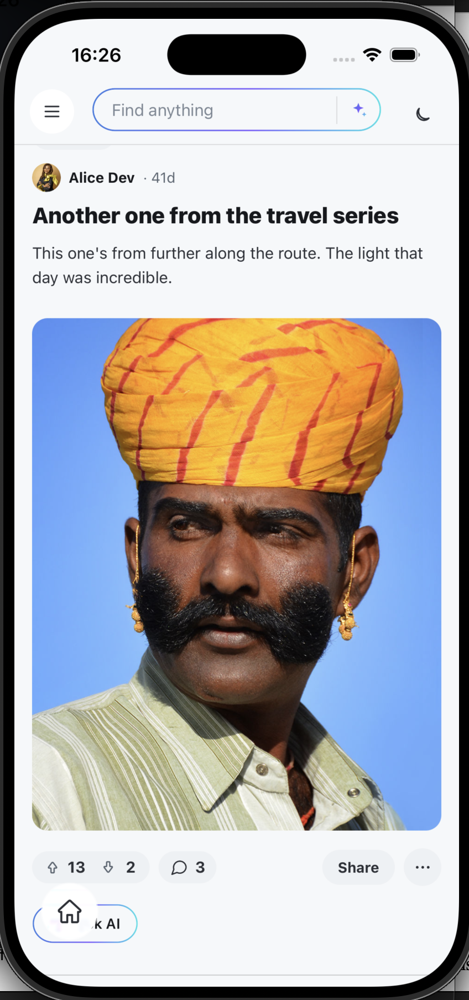
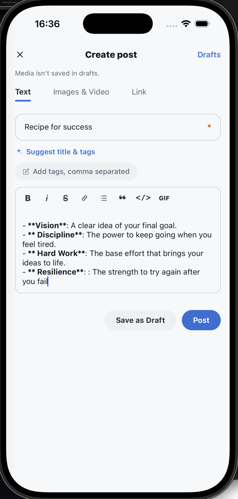
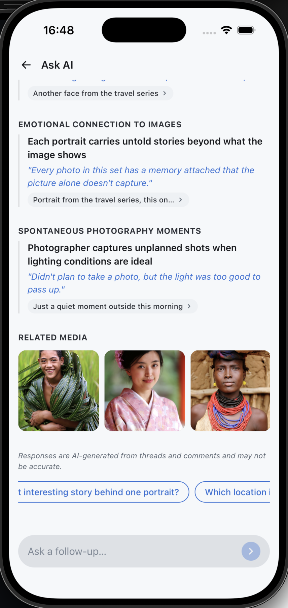
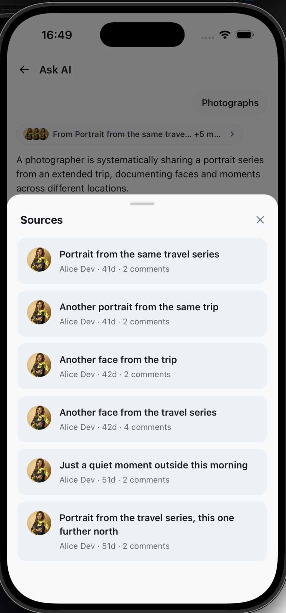

# @timpel/forumkit-sdk-react-native

Embeddable discussion forum for React Native / Expo applications. Add a full-featured forum - threads, nested comments, voting, search, drafts, media uploads, notifications, user profiles, admin moderation, and AI-powered features (summarise, suggest reply, Ask AI, duplicate detection) - to any Expo app with a single component.

**Supported platforms:**

| Platform | Support |
|----------|---------|
| iOS | Yes - iPhone and iPad |
| Android | Yes |
| Expo Web | No - use `@timpel/forumkit-sdk-web` for web |

---

## Requirements

- A running ForumKit API server - see the [self-hosting guide](https://github.com/oluwaseun-odueso/forumkit-sdk#quick-start)
- A backend that can sign short-lived JWTs with your `FORUM_SECRET_KEY`
- Expo SDK 57
- A custom development build (the SDK includes JSI native modules and cannot run in Expo Go)

---

<table>
  <tr>
    <td></td>
    <td></td>
    <td></td>
    <td></td>
  </tr>
</table>

---

## Multi-tenant

A single ForumKit API server can host any number of independent forums. Each forum is identified by a UUID (`forumId`) and all data - users, threads, posts, tags - is fully isolated between forums. You could run one forum per product, one per customer, or one per environment, all from the same deployment.

---

## Getting your Forum ID

The `forumId` you pass to the SDK is the UUID of a forum you have already created on your ForumKit API server. Here is how to create one and where to store it.

**Step 1 - Create the forum**

Call `POST /forums` on your ForumKit API. This endpoint requires an admin JWT signed with your `FORUM_SECRET_KEY`. When creating your very first forum, the `forumId` inside the bootstrap JWT does not need to point to an existing forum - the API accepts a placeholder:

```bash
# Sign a bootstrap JWT (replace YOUR_SECRET_KEY with your FORUM_SECRET_KEY)
# The forumId here is a placeholder - it only needs to be a valid UUID
BOOTSTRAP_TOKEN=$(node -e "
  const jwt = require('jsonwebtoken');
  const token = jwt.sign(
    { sub: 'admin', name: 'Admin', email: 'admin@example.com', role: 'admin', forumId: '00000000-0000-0000-0000-000000000000' },
    'YOUR_SECRET_KEY',
    { expiresIn: '5m', algorithm: 'HS256' }
  );
  console.log(token);
")

curl -X POST https://your-api.example.com/forums \
  -H "Authorization: Bearer $BOOTSTRAP_TOKEN" \
  -H "Content-Type: application/json" \
  -d '{ "name": "My Forum" }'
```

The response includes the forum's UUID:

```json
{ "id": "581e35a0-0ede-40bd-bc42-c9aea66dc11f", "name": "My Forum", ... }
```

**Step 2 - Store the forum ID in your backend**

Add it as an environment variable in your backend service:

```bash
FORUMKIT_FORUM_ID=581e35a0-0ede-40bd-bc42-c9aea66dc11f
```

**Step 3 - Pass it to the SDK**

Your token-minting endpoint reads from that env var and embeds it in the JWT `forumId` claim. The SDK picks it up from there - you never hardcode the UUID in your app code.

> **Development shortcut:** Running `npm run seed --workspace=packages/db` on your ForumKit server creates a sample forum and prints its UUID to the console.

---

## Installation

```bash
npm install @timpel/forumkit-sdk-react-native
```

The SDK has several peer dependencies that must be installed and linked in your Expo project:

```bash
npm install \
  expo@~57.0.16 \
  react@^19.2.3 \
  react-native@^0.86.2 \
  @react-navigation/native@^7.3.16 \
  @react-navigation/native-stack@^7.18.8 \
  react-native-screens@~4.26.0 \
  react-native-safe-area-context@~5.7.0 \
  react-native-reanimated@4.5.1 \
  react-native-svg@15.15.4 \
  react-native-worklets@0.10.x \
  @expensify/react-native-live-markdown@0.1.336 \
  @react-native-async-storage/async-storage@2.2.0 \
  expensify-common \
  expo-blur@~57.0.2 \
  expo-clipboard@~57.0.1 \
  expo-file-system@~57.0.4 \
  expo-font@~57.0.1 \
  expo-glass-effect@~57.0.1 \
  expo-image-manipulator@~57.0.11 \
  expo-image-picker@~57.0.11 \
  expo-status-bar@~57.0.1 \
  expo-video@~57.0.2
```

After installing, run a native build to link the native modules. You cannot use Expo Go for this - a custom dev build is required:

```bash
npx expo run:ios
# or
npx expo run:android
```

---

## Usage

```tsx
import { ForumKit } from '@timpel/forumkit-sdk-react-native';

export default function App() {
  return (
    <ForumKit
      forumId="YOUR_FORUM_ID"
      token={hostJwt}
      apiUrl="https://your-api.example.com"
      getToken={() => yourAuth.getFreshJwt()}
      onLogout={() => yourAuth.signOut()}
      theme={{ primaryColor: '#6200EE' }}
    />
  );
}
```

`ForumKit` is a full-screen component that includes its own navigation stack. Mount it at the root of your app or inside a dedicated screen.

---

## Configuration

| Prop | Type | Required | Description |
|------|------|:--------:|-------------|
| `forumId` | `string` | Yes | The forum's UUID, created via the ForumKit API. |
| `token` | `string` | Yes | A short-lived JWT signed by your backend. Used for the initial session exchange - see [Authentication](#authentication) below. |
| `apiUrl` | `string` | Yes | Base URL of your ForumKit API server. Required - there is no same-origin default inside a native app. |
| `getToken` | `() => Promise<string>` | No | Called to fetch a fresh host JWT for every session renewal. Without this, the session expires when `token` does. Strongly recommended for production. |
| `useHostTokenDirectly` | `boolean` | No | Skip the ForumKit session exchange and present your host JWT on every request. For Cognito, Auth0, or any setup that avoids a second token. Defaults to `false`. |
| `theme` | `ThemeTokens` | No | Colour overrides. See [Theming](#theming). |
| `onLogout` | `() => void` | No | Called when the user taps "Log Out". Your app owns the actual sign-out. Omit to hide the Log Out button entirely. |
| `brandName` | `string` | No | Replaces the "FORUM KIT" wordmark in the nav bar. Max 15 characters. |
| `brandNameFontFamily` | `string` | No | Font family for the brand name, independent of `theme`. Must be a font already registered with Expo (e.g. via `expo-font`). Defaults to Michroma. |
| `brandNameFontSize` | `string` | No | Font size for the brand name as a CSS-style string e.g. `'18px'`. Defaults to `'15px'`. |
| `mascot` | `React.ComponentType` | No | A React Native component that replaces the ForumKit mascot everywhere it appears - loading states, empty states, and the nav bar brand mark. Must accept no required props. |

### Using the mascot prop

Pass the component itself, not a rendered element:

```tsx
import { Image } from 'react-native';

// Define your mascot — all props must be optional so ForumKit can render it with none
function MyLogo() {
  return (
    <Image source={require('./assets/logo.png')} style={{ width: 80, height: 80 }} />
  );
}

// Pass the component reference, NOT <MyLogo />
<ForumKit
  forumId="YOUR_FORUM_ID"
  token={hostJwt}
  mascot={MyLogo}
/>
```

The component is rendered by ForumKit in loading states, empty states, and the nav bar. Because ForumKit passes no props to it, every prop on the component must have a default value or be entirely optional. Animated components (using RN `Animated`, Reanimated, or `react-native-svg`) work fine - ForumKit just mounts and unmounts the component as needed.

---

## Authentication

ForumKit supports two authentication modes. Choose the one that fits your setup.

### Standard mode (default)

Your backend mints a short-lived JWT, signs it with `FORUM_SECRET_KEY` (the same secret configured in your ForumKit API), and passes it to the SDK. On initialisation the SDK exchanges that JWT for its own internal session token and uses that for all subsequent requests. Your app never needs to know ForumKit's internal token exists.

**1. Set `FORUM_SECRET_KEY` in your ForumKit API `.env`:**

```bash
FORUM_SECRET_KEY=a-long-random-secret-only-your-servers-know
```

**2. Add an endpoint to your backend that mints the token:**

```ts
import jwt from 'jsonwebtoken';

app.get('/api/forumkit-token', requireAuth, (req, res) => {
  const token = jwt.sign(
    {
      sub: req.user.id,            // your app's user ID
      name: req.user.displayName,
      email: req.user.email,
      role: toForumKitRole(req.user.role), // 'guest' | 'member' | 'moderator' | 'admin'
      forumId: 'YOUR_FORUM_ID',
    },
    process.env.FORUM_SECRET_KEY,
    { expiresIn: '15m', algorithm: 'HS256' }
  );
  res.send(token);
});
```

**3. Pass the token to the SDK:**

```tsx
<ForumKit
  forumId="YOUR_FORUM_ID"
  apiUrl="https://your-api.example.com"
  token={await fetch('https://your-api.example.com/forumkit-token').then(r => r.text())}
  getToken={() => fetch('https://your-api.example.com/forumkit-token').then(r => r.text())}
/>
```

`getToken` is called automatically before each session renewal. Without it the session expires once the initial `token` does - always provide it in production.

### Existing users are migrated automatically

You do not need to pre-populate the ForumKit users table. On every login, ForumKit runs an upsert keyed on your `sub` (user ID) and `forumId`. If the user already exists their display name, email, and role are updated from the JWT. If they do not exist yet, their record is created on the spot. No data import or migration script is needed when connecting ForumKit to an existing user base.

---

### Direct host token mode (Cognito, Auth0, and similar)

If your app already authenticates users through an identity provider and you do not want a second token in your codebase, set `useHostTokenDirectly: true`. The SDK skips its own session exchange and presents your Access Token directly on every API request.

```tsx
import { Auth } from 'aws-amplify';

<ForumKit
  forumId="YOUR_FORUM_ID"
  apiUrl="https://your-api.example.com"
  token={cognitoAccessToken}
  useHostTokenDirectly={true}
  getToken={async () => {
    const session = await Auth.currentSession();
    return session.getAccessToken().getJwtToken();
  }}
/>
```

**Important - custom claims are required.** ForumKit reads `sub`, `name`, `email`, `role`, and `forumId` from every token. Your identity provider will not add these automatically - you must configure custom claims before using this mode.

For AWS Cognito, add a Pre Token Generation Lambda trigger:

```ts
exports.handler = async (event) => {
  event.response.claimsOverrideDetails = {
    claimsToAddOrOverride: {
      name: event.request.userAttributes.name,
      email: event.request.userAttributes.email,
      role: lookupRole(event.userName),  // map your Cognito group to 'member' | 'moderator' | 'admin'
      forumId: 'YOUR_FORUM_ID',
    },
  };
  return event;
};
```

The ForumKit API must also be pointed at your Cognito User Pool. Set `COGNITO_USER_POOL_ID` and `COGNITO_CLIENT_ID` in your API `.env` and the API will verify tokens against Cognito automatically.

---

## Theming

Pass a `ThemeTokens` object to the `theme` prop. On React Native, colour tokens are the primary lever - font family, border radius, and spacing are fixed native values.

```ts
theme={{
  primaryColor: '#6200EE',
  primaryColorHover: '#7B29F5',
  backgroundColor: '#0D0D0D',
  surfaceColor: '#1A1A1A',
  borderColor: '#2E2E2E',
  textPrimary: '#FFFFFF',
  textSecondary: '#A0A0A0',
}}
```

| Token | Description |
|-------|-------------|
| `primaryColor` | Accent colour for buttons, links, and active states. |
| `primaryColorHover` | Pressed/hover shade of the accent. |
| `backgroundColor` | App background. |
| `surfaceColor` | Card and panel background, one step above the app background. |
| `borderColor` | Subtle dividers and input borders. |
| `textPrimary` | Primary body text colour. |
| `textSecondary` | Muted labels and metadata. |

---

## Dark / light mode

The SDK has a built-in dark/light toggle, seeded from the user's OS preference and persisted per user. Your `theme` token overrides sit on top of whichever base palette is active - the switching continues to work underneath them.

---

## Forum settings

These settings live on the forum record itself and are updated via the ForumKit API (admin only). They apply to all users across all SDK platforms.

| Setting | Type | Default | Description |
|---------|------|---------|-------------|
| `isPublic` | `boolean` | `false` | When `true`, anyone can read threads without a token. Posting still requires authentication. |
| `aiEnabled` | `boolean` | `false` | Enable or disable all AI features (Summarise, Suggest reply, Ask AI, duplicate detection) for this forum. |
| `moderationThreshold` | `number` (0-1) | — | Posts with a toxicity score above this value are automatically hidden before anyone sees them. Requires `PERSPECTIVE_API_KEY` to be set on the API server. |
| `moderationReviewThreshold` | `number` (0-1) | — | Posts above this score are flagged for moderator review but remain visible. Useful as a softer gate below `moderationThreshold`. |
| `requireApproval` | `boolean` | `false` | Every new post is held for moderator approval before it appears on the forum. |
| `maxPostLength` | `number` | `10000` | Maximum character count for thread bodies and comments. |
| `newsTagName` | `string` | `'news'` | The tag name that drives the "News" scope in the sidebar. When a user creates a thread and applies this tag, that thread appears in the News section. The tag must also exist in your forum's tag list - create it via `POST /forums/:id/tags` using the same name. Example: set `newsTagName` to `'announcements'`, create a tag named `'announcements'`, and any thread tagged `announcements` shows up under News. |

Update settings via the API:

```bash
curl -X PATCH https://your-api.example.com/forums/YOUR_FORUM_ID/config \
  -H "Authorization: Bearer ADMIN_SESSION_TOKEN" \
  -H "Content-Type: application/json" \
  -d '{ "isPublic": true, "aiEnabled": true, "moderationThreshold": 0.8 }'
```

---

## Moderation

ForumKit has two moderation layers that work independently and can be combined.

### AI-powered auto-moderation

When `PERSPECTIVE_API_KEY` is set on the API server, every post is scored for toxicity in the background immediately after it is saved (the post is visible first, scored after - writes are never blocked). The score is a number from 0 to 1.

- **Score ≥ `moderationThreshold`** - the post is automatically hidden from all users. It remains in the database (soft delete) and is visible to moderators in the queue.
- **Score ≥ `moderationReviewThreshold`** - the post is flagged and added to the moderation queue for a human to review, but remains visible to users. Use this as an early-warning gate below the auto-hide threshold.

A typical setup: `moderationReviewThreshold: 0.5` (flag for review), `moderationThreshold: 0.8` (auto-hide).

Without `PERSPECTIVE_API_KEY` set, posts are saved with a score of `0` and no flags - moderation scoring is effectively off, but everything else works normally.

### User reporting

Users can report any post or thread from the UI. Reported items are added to the moderation queue with the reporter's reason attached.

### Require approval

When `requireApproval: true` is set on the forum, every new post is held in a pending state before it appears to anyone. Moderators approve or remove it from the queue. Use this for tightly controlled forums where all content needs sign-off.

### The moderation queue

Moderators and admins see a Moderation tab in the forum UI that lists all pending items - both AI-flagged posts and user-reported posts, oldest first. Each item can be **approved** (post becomes or stays visible) or **removed** (post is hidden).

The queue is also accessible via the API for custom moderation tooling:

```bash
# List pending items
curl https://your-api.example.com/moderation/queue \
  -H "Authorization: Bearer MOD_SESSION_TOKEN"

# Approve or remove an item
curl -X PATCH https://your-api.example.com/moderation/queue/ITEM_ID \
  -H "Authorization: Bearer MOD_SESSION_TOKEN" \
  -H "Content-Type: application/json" \
  -d '{ "action": "approved" }'   # or "removed"
```

---

## Media and file uploads

Two optional server-side features add rich media to the post composer. Neither is required - the forum works fully without them.

### File uploads (images, video)

File upload buttons appear in the composer when the ForumKit API server has S3-compatible storage configured. This works with AWS S3, Cloudflare R2, or a self-hosted MinIO instance.

Set these in your ForumKit API `.env`:

```bash
STORAGE_S3_BUCKET=your-bucket-name
STORAGE_S3_REGION=us-east-1
STORAGE_S3_ACCESS_KEY_ID=your-access-key
STORAGE_S3_SECRET_ACCESS_KEY=your-secret-key

# Optional - only needed for non-AWS endpoints (R2, MinIO, etc.)
STORAGE_S3_ENDPOINT=https://your-account.r2.cloudflarestorage.com

# Optional overrides (defaults shown)
STORAGE_MAX_FILE_SIZE_BYTES=26214400       # 25 MB
STORAGE_ALLOWED_MIME_TYPES=image/png,image/jpeg,image/gif,image/webp,video/mp4,video/webm
```

### GIF search

A GIF picker appears in the composer when a Giphy API key is configured on the API server. Free API keys are available at [developers.giphy.com](https://developers.giphy.com).

```bash
GIPHY_API_KEY=your-giphy-api-key
```

Without this key set, the GIF button still appears in the toolbar but opens a panel showing "GIF search coming soon" with the search input disabled.

---

## AI features

AI features are opt-in at the forum level (`aiEnabled: true`) and require the ForumKit API server to be configured with an LLM provider. The core forum works fully without them.

| Feature | Description |
|---------|-------------|
| **Summarise** | Generates a streaming bullet-point summary of a thread. |
| **Suggest reply** | Drafts a contextual reply based on the thread discussion. |
| **Ask AI** | RAG-based question answering over your forum's content, with cited source threads and follow-up suggestions. |
| **Duplicate detection** | Shows similar existing threads as a user drafts a new post, reducing duplicate questions. |

See the [AI Configuration](https://github.com/oluwaseun-odueso/forumkit-sdk#ai-configuration) section of the main repo for the required environment variables.

---

## Coming soon

**Communities** - group forums into named communities with their own membership, branding, and moderation settings. This feature is currently in development.

---

## Feedback & issues

> **Found a bug or have a feature request? Open an issue on GitHub:**
> **https://github.com/oluwaseun-odueso/forumkit-sdk/issues**

We read every issue. Please include your ForumKit version, SDK platform (web/native), and steps to reproduce.

---

## License

MIT © timpel
